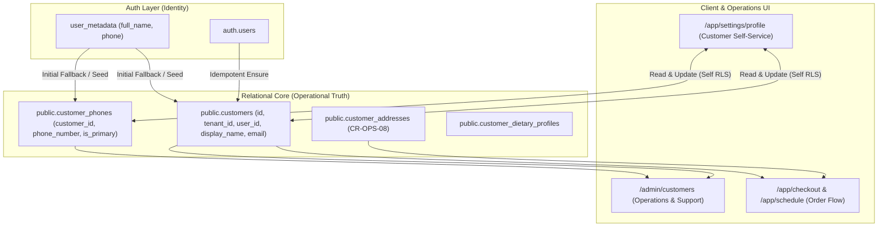

# CR-UX-CLIENT-02 · FASE 1: DISCOVERY & SCOPE LOCK REPORT
## Authentication & Customer Profile Architecture Lock

**Document ID:** `CR-UX-CLIENT-02-F1-SCOPE-LOCK`  
**Date:** 2026-10-03  
**Author:** AI Pair Architecture Engine (AG)  
**Governance Authority:** CR-GOV-01R / YourMeal OS Platform Constitution  
**Status:** 🔒 **SCOPE LOCKED — AWAITING HUMAN AUTHORIZATION FOR PHASE 2**

---

## 1. Executive Summary & Gaps Addressed

Following the successful production deployment of `CR-OPS-08` (B2C Delivery Address & Order Lifecycle), the platform addresses the next foundational customer debt: **CR-UX-CLIENT-02 · Authentication & Customer Profile**.

This Change Request targets two interconnected customer experience bottlenecks:

1. **GAP-AUTH-01 (Google Social Authentication)**:
   - *Current State*: The "Continuar con Google" button is absent from `/auth` in the Customer App.
   - *Root Cause*: Code-level feature flags `VITE_AUTH_GOOGLE_ENABLED` and `VITE_AUTH_OAUTH_SOCIAL_ENABLED` default to `false` in `src/auth/features.ts`, causing `src/routes/auth.tsx` to omit the social login container.
   - *Target State*: The Google OAuth button is conditionally rendered when configured, executing native Supabase PKCE social login, returning to `/auth/callback`, and smoothly materializing the user as a `customer` in `public.customers`.

2. **GAP-PROF-01 (Customer Profile Persistence & Synchronization)**:
   - *Current State*: In `/app/settings/profile`, the "Editar" button is disabled with a `comingSoon` badge. The view only displays read-only data directly from `auth.users.user_metadata` (e.g. `user?.user_metadata?.full_name`), with zero write-back capability or synchronization to relational customer tables.
   - *Target State*: The customer can edit their personal details (Display Name, Contact Phone) from `/app/settings/profile`. Edits persist directly to `public.customers` and `public.customer_phones`, protected by strict Row Level Security (`is_customer_owner`), and automatically reflect in real-time across the platform, including `/admin/customers` and the delivery address management system.

---

## 2. Deep Architectural Audit & Discovery Findings

### 2.1 Gate A: Google OAuth & PKCE Flow Analysis

A comprehensive audit of the authentication codebase revealed that the **code architecture for Supabase PKCE OAuth is 100% written, modern, and sound**:

- **`src/auth/oauth.ts`**:
  ```typescript
  export async function signInWithOAuth(provider: OAuthProvider): Promise<void> {
    const { auth } = getAuthClient();
    const redirectTo = oauthRedirectTo();
    const { error } = await auth.signInWithOAuth({
      provider,
      options: {
        redirectTo,
        queryParams: {
          access_type: "offline",
          prompt: "consent",
        },
      },
    });
    if (error) throw error;
  }
  ```
- **`src/auth/urls.ts`**:
  - Defines `oauthRedirectTo()` returning `${authOrigin()}/auth/callback`.
  - Automatically respects custom origins or defaults to `window.location.origin`.
- **`src/routes/auth_.callback.tsx`**:
  - Captures the PKCE auth code exchange via `handleAuthCallback(search)`.
  - Executes tenant association via `associateDeploymentAfterAuth`.
  - Seamlessly redirects the authenticated customer to `/app` or their intended target URL via `resolveHomePath`.
- **`src/routes/auth.tsx`**:
  - Social login section is guarded by:
    ```typescript
    const showSocialAuth = isGoogleOAuthEnabled() || isAppleOAuthEnabled();
    ```
  - When `isGoogleOAuthEnabled()` returns `false`, `showSocialAuth` evaluates to `false` and the social auth UI block returns `null`.

### 2.2 Gate B: External Infrastructure Matrix & Supabase Configuration

Enabling Google OAuth requires zero architectural redesign, but strictly requires external provider enablement in Supabase and Google Cloud Console.

#### Required Redirect URIs Matrix:

| Environment | Environment URL | Google Cloud Console (Authorized Javascript Origins) | Google Cloud Console (Authorized Redirect URIs) | Supabase Auth Allowed Callback URLs |
| :--- | :--- | :--- | :--- | :--- |
| **Local Dev** | `http://localhost:5173` | `http://localhost:5173` | `https://<supabase-project-id>.supabase.co/auth/v1/callback` | `http://localhost:5173/auth/callback` |
| **Staging** | `https://eatclean-staging.yourmealos.com` | `https://eatclean-staging.yourmealos.com` | `https://djangucecsphnejplvic.supabase.co/auth/v1/callback` | `https://eatclean-staging.yourmealos.com/auth/callback` |
| **Production** | `https://eatclean.yourmealos.com` | `https://eatclean.yourmealos.com` | `https://nhirlpkuvonggctdzzad.supabase.co/auth/v1/callback` | `https://eatclean.yourmealos.com/auth/callback` |

> [!IMPORTANT]
> **Safety Guard**: `VITE_AUTH_GOOGLE_ENABLED=true` must only be activated in environments where the Supabase Google Provider (Client ID & Client Secret) has been properly configured. In development/testing environments without Google credentials, mock authentication flows or explicit test stubs will be used.

---

### 2.3 Gate C: Customer Materialization & Idempotency Audit

When a user logs in via Google OAuth (or traditional Email/Password), their identity exists in `auth.users`. The platform ensures relational customer records through an existing, idempotent database procedure:

- **Procedure**: `public.ensure_individual_customer(p_tenant_id, p_user_id, p_display_name, p_email)`
- **Behavior**:
  1. Verifies membership in `tenant_members` (creates record if missing).
  2. Assigns default `customer` role in `user_roles` if missing.
  3. Inserts or fetches the `customers` row (`kind = 'individual'`, `user_id = auth.uid()`, `tenant_id = current_tenant`).
- **Idempotency**: Completely safe against duplicate logins, re-authentications, and concurrent sessions.

---

### 2.4 Gate D: Customer Profile Architecture & Source of Truth Matrix

#### Current vs. Target Source of Truth:



#### Field-by-Field Matrix:

| Domain Field | Operational Source of Truth | Initial Seed / Fallback | Write Access (Client App) | Write Access (Admin App) | Sync / Reflection |
| :--- | :--- | :--- | :--- | :--- | :--- |
| **Display Name** | `public.customers.display_name` | `auth.users.user_metadata.full_name` | Direct update via `customers` (RLS self-owner) | Operations manager via `/admin/customers` | Real-time query |
| **Email** | `auth.users.email` & `public.customers.email` | `auth.users.email` | Read-only in Profile (Managed via Auth) | Read-only (Managed via Auth) | Synchronized on sign-in |
| **Phone Number** | `public.customer_phones.phone_number` | `auth.users.user_metadata.phone` | Direct insert/update via `customer_phones` | Operations manager via `/admin/customers` | Real-time query |
| **Addresses** | `public.customer_addresses` | Managed via Address Drawer (CR-OPS-08) | CRUD via Address Drawer & Profile | Operations manager | Real-time query |
| **Dietary Profile** | `public.customer_dietary_profiles` | Preferences onboarding | Preferences View | Operations manager | Real-time query |

---

### 2.5 Gate E: Security & Row Level Security (RLS) Verification

All target tables already possess verified Row Level Security policies guaranteeing strict tenant and user boundary isolation:

1. **`public.customers`**:
   - `SELECT`: `customers_self_read` allows `user_id = auth.uid()` within tenant.
   - `UPDATE`: `customers_self_write` allows `user_id = auth.uid()` within tenant.
2. **`public.customer_phones`**:
   - `ALL`: `cphone_all` policy allows all CRUD operations where `is_customer_owner(customer_id)` is true.
3. **`public.customer_addresses`**:
   - `ALL`: `caddr_all` policy allows all CRUD operations where `is_customer_owner(customer_id)` is true (reinforced in CR-OPS-08).
4. **`public.customer_dietary_profiles`**:
   - `ALL`: `is_customer_owner(customer_id)`.

*Conclusion*: **Zero database schema changes or RLS migrations are required**. All backend models and security policies are already in place and certified.

---

## 3. Scope Demarcation & Exclusions

### 3.1 In Scope (CR-UX-CLIENT-02)
- **GAP-AUTH-01**:
  - Exposing Google OAuth button in `/auth` conditioned on `isGoogleOAuthEnabled()`.
  - Seamless redirection handling in `/auth/callback`.
  - Robust error handling for canceled / interrupted OAuth logins.
- **GAP-PROF-01**:
  - Transforming `/app/settings/profile` from static/disabled placeholder into a reactive, editable customer profile screen.
  - Creating `useCustomerProfile` / `useUpdateCustomerProfile` hook to read and mutate `public.customers` and `public.customer_phones`.
  - Adding editable dialog or inline edit form with schema validation (Zod) for Name and Phone.
  - Ensuring phone synchronization to `customer_phones` with `is_primary = true`.
  - Ensuring changes immediately reflect in `/admin/customers` without page reload.

### 3.2 Explicitly Out of Scope
- Apple OAuth integration (remains disabled).
- Modifying Supabase RLS policies (existing policies are complete and secure).
- Altering core auth engine or multi-factor authentication (MFA).
- Direct external modifications to Supabase Dashboard or Google Cloud Console within automated code pipelines (must be performed as infrastructure configuration).

---

## 4. Phase-by-Phase Roadmap (Phases 2 to 11)

```text
┌─────────────────────────────────────────────────────────────┐
│ FASE 1 · Discovery & Scope Lock            ✅ [COMPLETED]   │
│ FASE 2 · Architecture & Test Plan Design   🔒 [NEXT]        │
│ FASE 3 · Integration & Unit Test Suite     🔒 [PENDING]     │
│ FASE 4 · Implementation (UI & Services)    🔒 [PENDING]     │
│ FASE 5 · Local Quality Gates Certification 🔒 [PENDING]     │
│ FASE 6 · Local Commit                      🔒 [PENDING]     │
│ FASE 7 · Remote Push & Branch Sync         🔒 [PENDING]     │
│ FASE 8 · Pull Request Creation             🔒 [PENDING]     │
│ FASE 9 · CI & Gate Certification           🔒 [PENDING]     │
│ FASE 10 · Staging Deployment & Validation  🔒 [PENDING]     │
│ FASE 11 · Production Deployment & Closure  🔒 [PENDING]     │
└─────────────────────────────────────────────────────────────┘
```

---

## 5. Phase 1 Sign-Off & Strict Stop Declaration

In accordance with Platform Constitution **CR-GOV-01R**:
- No production database was modified.
- No staging database was modified.
- No application code was altered.
- No git commits or branches were created.
- Discovery and architectural analysis are 100% complete and documented.

🛑 **STRICT STOP ACTIVE: Awaiting explicit human authorization to proceed to FASE 2 (Architecture & Test Plan Design).**
