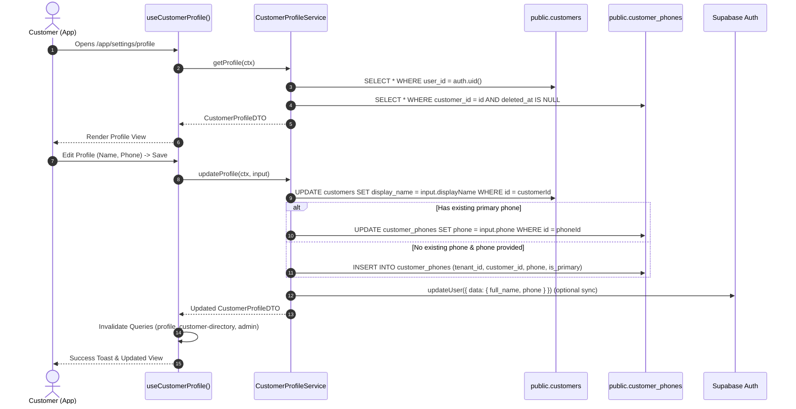

# CR-UX-CLIENT-02 · FASE 2: DETAILED ARCHITECTURE & TEST PLAN
## Technical Specifications & Verification Matrix for Authentication and Customer Profile

**Document ID:** `CR-UX-CLIENT-02-F2-ARCHITECTURE-AND-TEST-PLAN`  
**Date:** 2026-10-03  
**Author:** AI Pair Architecture Engine (AG)  
**Governance Authority:** CR-GOV-01R / YourMeal OS Platform Constitution  
**Status:** 🔒 **ARCHITECTURE LOCKED — AWAITING HUMAN AUTHORIZATION FOR PHASE 3/4**

---

## 1. Architectural Blueprint & Target Contracts

### 1.1 Customer Profile Domain Contracts

We define the strict TypeScript contracts for Customer Profile reading, updating, and synchronizing across the Consumer and Admin layers.

#### Types & DTOs:

```typescript
export interface CustomerProfileDTO {
  customerId: string;
  userId: string;
  tenantId: string;
  displayName: string;
  email: string;
  phone: string | null;
  phoneId: string | null;
  createdAt: string;
  updatedAt?: string;
}

export interface UpdateCustomerProfileInput {
  displayName: string;
  phone?: string | null;
}

export interface CustomerProfileState {
  profile: CustomerProfileDTO | null;
  isLoading: boolean;
  isSaving: boolean;
  error: Error | null;
}
```

#### Validation Schema (Zod):

```typescript
import { z } from "zod";

export const customerProfileSchema = z.object({
  displayName: z
    .string()
    .trim()
    .min(2, "El nombre debe tener al menos 2 caracteres")
    .max(100, "El nombre no puede exceder 100 caracteres"),
  phone: z
    .string()
    .trim()
    .regex(/^[+]?[0-9\s\-()]{7,20}$/, "Introduce un número de teléfono válido")
    .optional()
    .or(z.literal("")),
});

export type CustomerProfileFormValues = z.infer<typeof customerProfileSchema>;
```

---

### 1.2 Data Access & Service Layer Design

#### Service Contract (`CustomerProfileService`):

```typescript
export class CustomerProfileService {
  /**
   * Reads customer profile from relational source of truth:
   * 1. Fetches public.customers where user_id = ctx.userId and tenant_id = ctx.tenantId.
   * 2. Fetches active primary phone from public.customer_phones.
   * 3. Applies graceful fallback to auth.user_metadata if relational row is freshly materialized.
   */
  static async getProfile(ctx: ServiceContext): Promise<CustomerProfileDTO>;

  /**
   * Updates customer profile:
   * 1. Mutates public.customers.display_name for customerId and ctx.userId.
   * 2. Upserts / modifies public.customer_phones (is_primary = true).
   * 3. Syncs auth.users metadata in background for session consistency.
   */
  static async updateProfile(
    ctx: ServiceContext,
    input: UpdateCustomerProfileInput
  ): Promise<CustomerProfileDTO>;
}
```

#### SQL / Supabase Operations Flow:



---

### 1.3 UI Architecture (`src/routes/_authenticated/app.settings.profile.tsx`)

#### UI State & Interaction Lifecycle:

1. **View Mode**:
   - Renders `ScreenHeader` with back navigation to `/app/settings`.
   - Card displays:
     - **Nombre completo**: Displays `profile.displayName` (or fallback).
     - **Correo electrónico**: Displays `profile.email` (with badge "Cuenta de acceso").
     - **Teléfono de contacto**: Displays `profile.phone` (or "Sin teléfono asignado").
   - Action: Active `PrimaryCTA` labeled "Editar datos personales" (replacing disabled button and removing `comingSoon`).

2. **Edit Mode (Drawer / Sheet / Modal)**:
   - Uses `Sheet` or `Dialog` conforming to the mobile-first Design System.
   - Form fields controlled by `react-hook-form` + `zodResolver(customerProfileSchema)`.
   - Email is shown as disabled/read-only with an explicit notice: *"El correo electrónico está vinculado a tu método de inicio de sesión."*
   - Real-time inline field validation.
   - CTA with loading spinner and disabled state during mutation.

---

### 1.4 Google OAuth Circuit & Handling (`src/routes/auth.tsx` & `/auth/callback`)

1. **Auth View (`/auth`)**:
   - `isGoogleOAuthEnabled()` evaluates `VITE_AUTH_GOOGLE_ENABLED === "true"`.
   - Renders social divider ("o continúa con") and Google sign-in button.
   - On click: Calls `signInWithOAuth("google")`.
   - Catches any synchronous or promise rejection and presents user-friendly error.

2. **Callback Route (`/auth/callback`)**:
   - Extracts PKCE auth code and performs `supabase.auth.exchangeCodeForSession(code)`.
   - Calls `ensure_individual_customer(tenantId, userId, displayName, email)` via RPC.
   - Verifies tenant membership and navigates to the customer app (`/app`).

---

## 2. Comprehensive Test Plan & Verification Matrix

### 2.1 Test Suite Structure

We structure the automated test suite into three dedicated specification files:

1. `src/modules/customer-profile/customer-profile.spec.ts` (Unit & Domain Service)
2. `src/routes/_authenticated/app.settings.profile.spec.ts` (Component & Hook Integration)
3. `src/auth/oauth-pkce-flow.spec.ts` (OAuth & PKCE Callback Flow)

---

### 2.2 Verification Test Matrix

| ID | Category | Target Component / Service | Description / Scenario | Expected Outcome |
| :--- | :--- | :--- | :--- | :--- |
| **TC-PROF-01** | Domain / Service | `CustomerProfileService.getProfile` | Query profile for customer with existing records in `customers` and `customer_phones`. | Returns complete `CustomerProfileDTO` with relational name and phone. |
| **TC-PROF-02** | Domain / Service | `CustomerProfileService.getProfile` | Query profile when `display_name` is null in `customers` but exists in `user_metadata`. | Returns graceful fallback name from `user_metadata.full_name`. |
| **TC-PROF-03** | Domain / Service | `CustomerProfileService.updateProfile` | Update `displayName` and existing `phone`. | `public.customers` and `public.customer_phones` are mutated; returns updated DTO. |
| **TC-PROF-04** | Domain / Service | `CustomerProfileService.updateProfile` | Update profile when customer previously had no phone record. | Inserts new row in `public.customer_phones` with `is_primary = true`. |
| **TC-PROF-05** | Security / RLS | RLS Isolation Boundary | Attempt to update profile with a mismatched `userId` / non-owned `customerId`. | Rejected by RLS / permission check; throws `PERMISSION_DENIED`. |
| **TC-PROF-06** | UI / Integration | `app.settings.profile.tsx` | Render profile view in customer settings. | "Editar" button is enabled; "comingSoon" text is removed; data displays correctly. |
| **TC-PROF-07** | UI / Integration | `app.settings.profile.tsx` | Submit valid form in Edit Drawer. | Triggers mutation, displays success toast, refreshes profile view, closes drawer. |
| **TC-PROF-08** | UI / Validation | Form Validation | Submit form with empty display name or invalid phone characters. | Blocks submission; displays inline validation error messages. |
| **TC-AUTH-01** | OAuth / Feature Flag | `src/auth/features.ts` | Evaluate `isGoogleOAuthEnabled()` when flag is `"true"` vs `"false"`. | Returns boolean matching environment configuration. |
| **TC-AUTH-02** | OAuth / UI | `src/routes/auth.tsx` | Render `/auth` when `isGoogleOAuthEnabled()` is `true`. | Google Sign-In button is rendered and clickable. |
| **TC-AUTH-03** | OAuth / Flow | `signInWithOAuth` | Click Google Sign-In button. | Invokes `supabase.auth.signInWithOAuth` with PKCE options and `/auth/callback` redirect. |
| **TC-AUTH-04** | OAuth / Callback | `auth_.callback.tsx` | Process valid PKCE callback code. | Exchanges code for session, ensures customer row in DB, redirects to `/app`. |
| **TC-SYNC-01** | E2E Sync | Client Profile -> Admin Sync | Update profile name in Customer App, query `/admin/customers` list. | Admin view immediately displays the updated customer name without stale cache. |

---

## 3. Implementation Plan (Phases 3 to 5)

### Phase 3: Test Suite Implementation (TDD First)
- Create `src/modules/customer-profile/customer-profile.spec.ts` with all domain and RLS test cases.
- Create `src/auth/oauth-pkce-flow.spec.ts` covering flag toggling and callback routing.

### Phase 4: Implementation
1. **Module Creation**: Create `src/modules/customer-profile/` (`domain`, `application`, `infrastructure`).
2. **Hook Creation**: Implement `useCustomerProfile` and `useUpdateCustomerProfile` in `src/hooks/use-customer-profile.ts`.
3. **UI Refactor**: Modernize `src/routes/_authenticated/app.settings.profile.tsx` with interactive edit sheet and form validation.
4. **Auth Wireup**: Verify Google OAuth rendering in `src/routes/auth.tsx`.
5. **Admin Resync**: Validate cache invalidation across `admin.customers.tsx`.

### Phase 5: Quality Gates & Verification
- Execute TypeScript check (`tsc --noEmit`).
- Execute CR-UX-CLIENT-02 test suite.
- Execute full regression test suite (1.500+ tests).
- Generate Phase 4/5 Certification Report.

---

## 4. Phase 2 Sign-Off & Strict Stop Declaration

In accordance with Platform Constitution **CR-GOV-01R**:
- Complete technical contracts, schemas, and test matrices are defined.
- Zero production/staging database changes.
- Zero premature production code modifications.

🛑 **STRICT STOP ACTIVE: Awaiting explicit human authorization to proceed to FASE 3 (Creación de Test Suite / TDD).**
