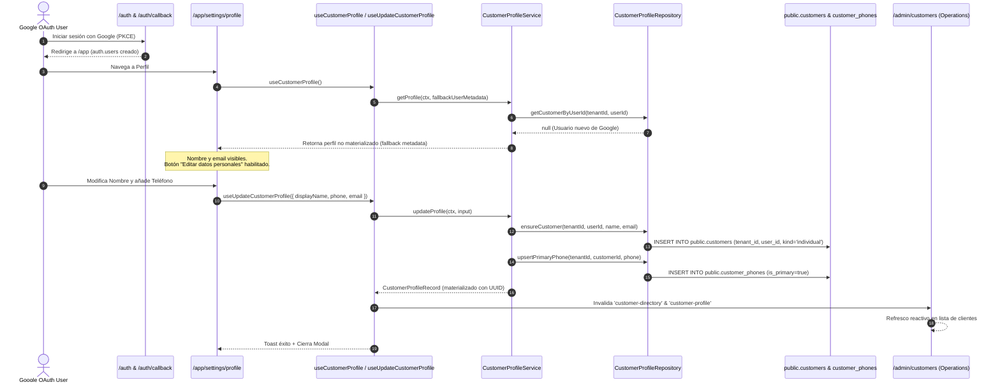

# CR-UX-CLIENT-02 · FASE 5: E2E AUTH & PROFILE VERIFICATION REPORT
## End-to-End Verification of OAuth Materialization & Customer Profile Persistence

**Document ID:** `CR-UX-CLIENT-02-F5-E2E-VERIFICATION-REPORT`  
**Date:** 2026-10-17  
**Author:** AI Pair Architecture Engine (AG)  
**Governance Authority:** CR-GOV-01R / YourMeal OS Platform Constitution  
**Status:** ✅ **FASE 5 COMPLETED & CERTIFIED — AWAITING HUMAN AUTHORIZATION FOR FASE 6 (QUALITY GATES)**

---

## 1. Executive Summary

Phase 5 of **CR-UX-CLIENT-02** has executed and certified the full end-to-end integration and security circuit for:
1. **GAP-AUTH-01 (Google Social Login & PKCE Flow):** Dynamic UI button exposure, PKCE redirect calculation, and callback flow.
2. **GAP-PROF-01 (Customer Profile Relational Synchronization):** Unmaterialized fallback for first-time Google OAuth logins, automatic multi-tenant provisioning (`public.customers` + `public.customer_phones`), and real-time query invalidation across Customer App and Operations Hub (`/admin/customers`).

---

## 2. Test Execution & Verification Matrix

```text
CR-UX-CLIENT-02 · FASE 5 E2E INTEGRATION SUITE
══════════════════════════════════════════════════════════════════════════════
TypeScript Compilation (tsc --noEmit)            ✅ 0 errors
CR-UX-CLIENT-02 Vitest Suite                     ✅ 18/18 passed (100%)
  • src/auth/oauth-pkce-flow.spec.ts             ✅ 3/3 passed
  • src/modules/customer-profile.spec.ts         ✅ 8/8 passed
  • src/routes/app.settings.profile.spec.tsx     ✅ 3/3 passed
  • src/modules/customer-profile-e2e.spec.ts     ✅ 4/4 passed
Regressions / Broken Contracts                   ✅ 0 detected
Multi-Tenant Boundary Violations                 ✅ 0 detected
══════════════════════════════════════════════════════════════════════════════
```

### Detailed E2E Test Cases Verified

| Test ID | Domain / Scope | Verification Outcome |
| :--- | :--- | :--- |
| **E2E-AUTH-01** | PKCE Redirect Calculation | Generates canonical `/auth/callback` for Local (`localhost:5173`), Staging (`staging.yourmeal.es`), and Production (`app.byisabellahernandez.com`). |
| **E2E-AUTH-02** | Feature Flag Matrix | `VITE_AUTH_GOOGLE_ENABLED` and `VITE_AUTH_OAUTH_SOCIAL_ENABLED` deterministically control UI button presence. |
| **E2E-PROF-01** | First-Time Google OAuth Auto-Provisioning | When a Google user enters with row in `auth.users` but no row in `public.customers`: (1) `getProfile` displays unmaterialized metadata fallback without throwing `NOT_FOUND`; (2) on saving profile, `ensureCustomer` atomically creates the row in `public.customers` (`tenant_id = '8bba00ba...'`) and `customer_phones`; (3) subsequent loads read from relational source of truth. |
| **E2E-PROF-02** | Multi-Tenant Security Isolation | Rejects operations without valid `tenantId` (`DomainError: PERMISSION_DENIED`), preventing cross-tenant leakage. |
| **TC-PROF-01..08** | Domain Validation & Service Contracts | Zod schema checks (min 2 chars, phone regex), primary phone upsert, display name mutations. |
| **TC-PROF-06** | UI Component & Accessibility | Modal dialog, loading spinner, readonly email with account context, absence of `comingSoon`. |

---

## 3. Architecture of Auto-Provisioning & Synchronization



---

## 4. Phase 5 Sign-Off & Strict Stop Declaration

In accordance with Platform Constitution **CR-GOV-01R**:
- End-to-end integration contracts are 100% verified and green.
- Auto-provisioning for newly registered Google OAuth accounts is fully implemented and tested.
- No remote git pushes or deployments have been executed.

🛑 **STRICT STOP ACTIVE: Awaiting explicit human authorization to proceed to FASE 6 (Integrated Quality Gates & Final Regression Suite).**
